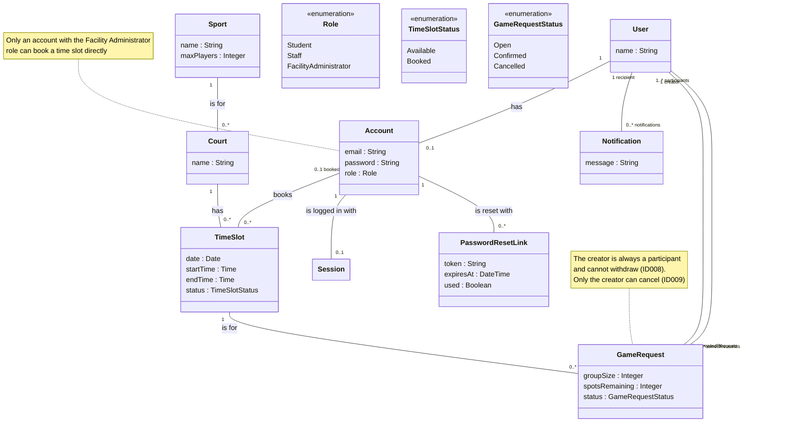

# Huddle Domain Model

This is the domain model for the Sprint A stories (ID004, ID005, ID006, ID007, ID008, ID009 and ID010) and the Sprint B account stories (ID001 Create Account, ID002 Log In, ID011 Reset Password). It is based on the scenarios in our feature files and will be updated during the sprint if needed.

Association names read: a Court *is for* a Sport, a Court *has* TimeSlots, an Account *books* TimeSlots, a GameRequest *is for* a TimeSlot, a User *has* an Account, an Account *is logged in with* a Session and an Account *is reset with* PasswordResetLinks.

## Classes

- **Sport**: a sport offered in Huddle. maxPlayers is the max number of players in one game (Squash 2, Badminton 4, Basketball 10).
- **Court**: a court for one sport (e.g. Squash Court 1).
- **TimeSlot**: a period on a court. Its status is Available or Booked.
- **GameRequest**: a game posted by a user for a time slot. groupSize is the number of players the creator brings and spotsRemaining is how many more players are needed.
- **User**: a Huddle user, identified by name. A user can create game requests and join other users' game requests, and receives notifications.
- **Account**: the registered account of a user (ID001). The email is a McGill address (@mail.mcgill.ca for students, @mcgill.ca for staff), unique in any case. The password can be changed with a reset link (ID011).
- **Role**: what an account can do. A new @mail.mcgill.ca account is a Student and a new @mcgill.ca account is Staff. A Facility Administrator can book time slots directly and publish time slots (ID003).
- **Session**: the active session started when an account logs in with its email and password (ID002). It carries the account's role. Logging in again replaces it.
- **PasswordResetLink**: a link sent by email to reset an account's password (ID011). It expires at expiresAt and can be used only once, after which it is Used. A request for an email without an account creates no link, but gives the same message.
- **Notification**: a message sent to a user, e.g. when their game is cancelled because its time slot was booked, or when the creator cancels a game they joined.
- **TimeSlotStatus**: Available, or Booked once a game is confirmed or an administrator books the slot. A Booked slot goes back to Available when its confirmed game is cancelled.
- **GameRequestStatus**: Open while spots remain, Confirmed when the last spot is filled, Cancelled when the time slot is no longer available or the creator cancels the game. A Confirmed game goes back to Open when a participant withdraws. A cancelled game keeps its participants.
