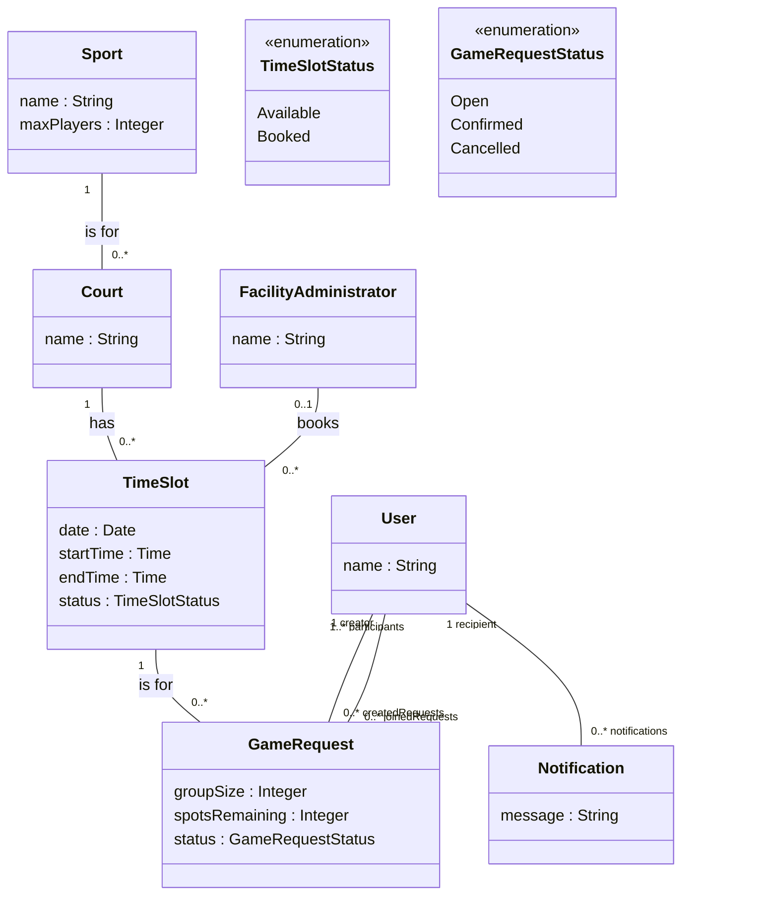

# Huddle Domain Model

This is the domain model for the Sprint A stories (ID004, ID005, ID006, ID007 and ID010). It is based on the scenarios in our feature files and will be updated during the sprint if needed.

The diagram is written in [Mermaid](https://mermaid.js.org/syntax/classDiagram.html): GitHub renders it in this file, and it can be edited or exported as an image at <https://mermaid.live>.

## Classes

- **Sport**: a sport offered in Huddle. maxPlayers is the max number of players in one game (Squash 2, Badminton 4, Basketball 10).
- **Court**: a court for one sport (e.g. Squash Court 1).
- **TimeSlot**: a period on a court. Its status is Available or Booked.
- **GameRequest**: a game posted by a user for a time slot. groupSize is the number of players the creator brings and spotsRemaining is how many more players are needed.
- **User**: a Huddle user. A user can create game requests and join other users' game requests, and receives notifications.
- **Notification**: a message sent to a user, e.g. when their game is cancelled because its time slot was booked.
- **FacilityAdministrator**: a McGill facility administrator, who can book a time slot directly.
- **TimeSlotStatus**: Available, or Booked once a game is confirmed or an administrator books the slot.
- **GameRequestStatus**: Open while spots remain, Confirmed when the last spot is filled, Cancelled when the time slot is no longer available.
